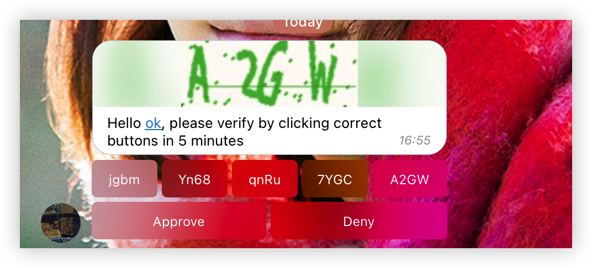
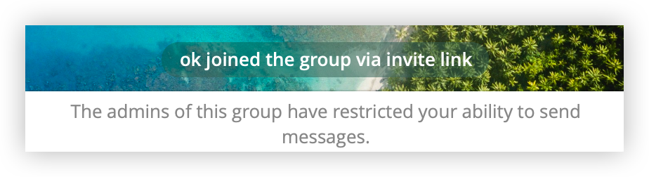

# Captcha Bot

Captcha challenge for group.

[https://t.me/benny_captcha_bot](https://t.me/benny_captcha_bot)


# screenshot




# Usage:

add bot to your group, assign it with admin privileges, and you're good to go.

# Deploy

environment variables:

* API_ID
* API_HASH
* BOT_TOKEN
* REDIS

Spam 学习功能已接入现有规则删除路径，功能默认关闭：

* `SPAM_LEARNING_ENABLED`：默认 `false`
* `SPAM_ADMIN_ID`：唯一接收审核通知的 Telegram 管理员用户 ID（正整数）
* `D1_ACCOUNT_ID`
* `D1_DATABASE_ID`
* `D1_API_TOKEN`
* `SPAM_MODEL_PATH`：默认 `models/spamdet`
* `SPAM_CAPTURE_QUEUE_SIZE`：有界队列容量，默认 `100`
* `SPAM_CAPTURE_WORKERS`：后台采集 worker 数，默认 `2`
* `SPAM_INFERENCE_CONCURRENCY`：本地模型推理最大并发数，默认 `2`
* `SPAM_BIO_TIMEOUT_SECONDS`：Bio 查询超时，默认 `2.0`
* `SPAM_BIO_CACHE_TTL_SECONDS`：Bio 缓存 TTL，默认 `300.0`
* `SPAM_BIO_CACHE_SIZE`：Bio 缓存最大条目数，默认 `1000`
* `SPAM_CAPTURE_SHUTDOWN_TIMEOUT_SECONDS`：关停排空超时，默认 `5.0`
* `SPAM_CAPTURE_GROUPS`：默认不记录普通群消息；`all` 记录所有可见群，或用 `-100123,-100456` 只记录指定群。

普通群消息只采集有文本或 caption、未命中规则的消息；D1 保存为未标注的 `group/pending`，不会自动当作 Ham。管理员在私聊发送 `/review`，每次领取一条并用 Spam/Not Spam 按钮审核。普通消息不主动推送通知；Handler 为既有 Bio 规则取得用户资料后，会复用该 Bio 写入样本，不增加 Telegram 请求。D1 使用 Story 010 的全新 Schema v2，启用前应在确认目标后重建数据库并执行 `python -m spamdet.d1_migrate --apply`，不支持旧表升级或记录回填。

启用 `SPAM_LEARNING_ENABLED` 时，单个管理员 ID 和三项 D1 配置必须存在。
所有密钥只能通过环境变量或 Secret 注入。
规则删除前只做同步内存快照；Bio 和 D1 请求在有界后台队列中执行。队列已满时丢弃采集任务，不影响删除。
只有 D1 pending 写入成功后才会私聊该管理员。管理员可在 Bot 私聊中使用 `/dataset`
查看聚合统计，使用 `/model` 查看模型可用性、类型、版本和预测语义；这两个命令都不会
向其他用户开放。

审核通知发送失败时样本仍保留为 pending，V1 不自动补发。可先用 `/dataset` 确认
pending 数量，然后在 Cloudflare D1 Console 中定位未审核记录：

```sql
SELECT id, created_at, review_chat_id, review_message_id
FROM samples
WHERE status = 'pending'
ORDER BY id ASC;
```

`review_chat_id`/`review_message_id` 为 NULL 通常表示未成功记录审核通知，需要人工查看 D1
中该样本并决定后续处理；不得因为规则命中而直接将它标为 Spam。

## 初始相似度模型

初始模型使用 `spam.txt` 中人工确认的 Spam 正例构建字符 n-gram TF-IDF 模型。它只输出
`spam_like`、`unknown` 或 `unavailable` 建议；分数是余弦相似度，不是 Spam 概率，
也不会触发删除、封禁或禁言。

训练默认读取 UTF-8 的 `spam.txt`，每行一条，输出到现有 `SPAM_MODEL_PATH` 默认目录：

```shell
python -m spamdet.seed_model --input spam.txt --output models/spamdet
```

也可以使用 Make 目标；默认值与上面的命令一致：

```shell
make train-spam-model
```

需要使用虚拟环境或其他路径时可覆盖变量，例如：

```shell
make train-spam-model PYTHON=venv/bin/python SPAM_SEED_INPUT=spam.txt SPAM_MODEL_OUTPUT=models/spamdet
```

训练并立即演示，或单独加载模型演示：

```shell
python -m spamdet.seed_model --input spam.txt --output models/spamdet --text "测试文本"
python -m spamdet.seed_model --model models/spamdet --text "测试文本"
```

输出会显示最近的原始种子和“相似度”。默认阈值为 `0.65`，只是没有 Ham 数据时的
保守启发式值，可在训练时用 `--threshold` 修改并固化到 manifest。默认移除常见零宽
控制符；只有明确需要保留时才使用 `--keep-zero-width`。

模型格式 v2 支持 message、Bio 和 display_name 三个隔离通道，默认权重分别为 1.0、0.75、
0.25；username 和 user ID 不参与模型。仅由 `spam.txt` 构建的初始镜像模型没有 Bio/姓名语料，
这些通道需要在 D1 获得人工 reviewed 数据后通过重训候选生效。模型包由 `manifest.json` 和内容哈希命名的 JSON artifact 构成。加载时校验 SHA-256、
格式版本、路径和结构；不使用 `pickle` 或 `joblib`，也不应加载来源不可信的模型目录。
相同语料和参数会生成相同模型版本与字节内容。Story 006 在 Spam 学习功能启动时加载一次
模型，并在删除完成后的有界后台采集路径中推理。推理在线程池执行并受
`SPAM_INFERENCE_CONCURRENCY` 限制；加载或推理失败时记录 `unavailable`，仍继续写入
D1 pending 并发送人工审核通知。推理日志只记录 decision 和耗时，不记录消息原文、Bio
或最近样本。

正式 Docker 镜像在构建阶段执行 `make train-spam-model`，从仓库内的 `spam.txt` 生成
确定性初始相似度模型，并将产物复制到镜像内的
`/CaptchaBot/models/spamdet`。镜像默认将 `SPAM_MODEL_PATH` 指向该目录，因此运行时
不需要模型 bind mount，也不会下载或在线训练模型。更换 `spam.txt` 后必须重新构建镜像。

## 人工审核数据重训

重训将导出、候选构建和批准拆成三个显式阶段。format v2 JSONL 包含人工审核的消息、Bio、
显示名称和不可逆用户分组摘要，
只能保存在受控本地目录；仓库默认忽略 `local/`。导出只读取 D1 中 `status=reviewed` 且标签为
`spam`/`ham` 的记录，并与 `spam.txt` 合并：

```shell
python -m spamdet.retrain export --seed spam.txt --output local/spam-retrain.jsonl
```

没有 Ham 时仍可构建相似度候选。输出为内容版本化候选目录，不会覆盖当前
`SPAM_MODEL_PATH`：

```shell
python -m spamdet.retrain build --dataset local/spam-retrain.jsonl --candidates models/candidates
```

只有明确传入 `--classifier`，并且 Spam/Ham 各自至少能形成两个独立用户/消息/Bio 连通分组时，才会训练字符
TF-IDF + Logistic Regression；否则安全回退为相似度候选。这个可评估条件不是质量保证。
若只有一类有 Bio，构建会拒绝，避免学习“是否缺失 Bio”的来源捷径。分组留出结果会在同一测试集
比较 message-only、message+bio、message+bio+display_name，并记录 Precision、Recall、误报数和混淆矩阵：

```shell
python -m spamdet.retrain build \
  --dataset local/spam-retrain.jsonl --candidates models/candidates --classifier
```

可选固定回归集为 UTF-8 JSONL，每行包含 `format_version=1`、人工标签 `label` 和 `text`，
例如 `{"format_version":1,"label":"ham","text":"今晚一起吃饭"}`。真实 Telegram 内容不得提交
到 Git。提供旧模型时必须同时提供回归集：

```shell
python -m spamdet.retrain build \
  --dataset local/spam-retrain.jsonl --classifier \
  --regression local/regression.jsonl --old-model models/releases/<old-version>
```

构建只产生候选。检查 manifest、评估及回归报告后必须显式批准；批准前会重新安全加载并核对
版本，已有 release 绝不覆盖：

```shell
python -m spamdet.retrain approve \
  --candidate models/candidates/<candidate> --releases models/releases --approved-by <operator>
```

批准不会修改运行中的 Bot，也不会自动部署。手动发布时将 `SPAM_MODEL_PATH` 设置为输出的
`models/releases/<model-version>` 并重启；回滚时改回上一个 release 并重启。二分类
`spam`/`ham` 仍只是管理员建议，分数是未校准 Spam 分数，不能触发删除、封禁或禁言。

等价 Make 入口为 `make export-spam-dataset`、`make build-spam-candidate` 和
`make approve-spam-candidate CANDIDATE=... APPROVED_BY=...`。分类器和回归参数建议直接使用
Python CLI，避免 Make 变量隐式改变发布语义。

## Makefile targets

运行 `make` 或 `make help` 可以查看全部入口。它们都不是 Bot 每次启动前必须执行的命令：

| Target | 用途 | 什么时候需要 |
| --- | --- | --- |
| `help` | 只显示 target 摘要，不修改任何状态 | 不确定命令时使用 |
| `train-spam-model` | 从 `spam.txt` 重建初始相似度模型 | 修改种子或模型代码后；Docker 构建会自动调用，日常运行不需要 |
| `export-spam-dataset` | 从 D1 导出 reviewed 数据并合并 `spam.txt` | 准备人工重训时的第一步；需要 D1 凭证，输出含敏感原文 |
| `build-spam-candidate` | 从本地 JSONL 构建未批准候选 | 人工重训第二步；不会批准或部署 |
| `approve-spam-candidate` | 将审查后的候选复制为不可覆盖 release | 人工重训第三步；需要 `CANDIDATE` 和 `APPROVED_BY`，仍不会部署 |
| `spam` | 将一个或多个 D1 样本人工标注为 Spam | 人工确认样本后使用；需要 D1 凭证、`SPAM_ADMIN_ID` 和 `id=1,2,3` |
| `ham` | 将一个或多个 D1 样本人工标注为 Ham | 人工确认样本后使用；需要 D1 凭证、`SPAM_ADMIN_ID` 和 `id=1,2,3` |
| `reset-d1` | 永久删除并重建 D1 `samples` 表 | 仅限允许丢弃全部样本的开发阶段；正常运行、重训和发布都不需要 |

通常你只需要直接启动 Bot。只有修改 `spam.txt` 才手工运行 `train-spam-model`；只有准备使用
人工标签重训时才按顺序执行 export、build、approve。`reset-d1` 不是维护命令，而是当前可丢弃
开发数据时的重建工具。

人工核对样本后可以批量标注；两条命令都会把 `status`、`label`、`reviewed_at`、
`reviewed_by` 以及 `message_json` 内的状态同步正确：

```shell
export D1_ACCOUNT_ID=...
export D1_DATABASE_ID=...
export D1_API_TOKEN=...
export SPAM_ADMIN_ID=123456
make ham id=1,2,3,4,5
make spam id=6,7
```

重复 ID 会去重。已 reviewed 的样本可用该入口纠正标签，并以当前时间和 `SPAM_ADMIN_ID`
记录本次操作；如果批次中任一 ID 不存在，整批不会更新。标签必须来自人工确认，不能根据规则
命中或模型建议直接批量标注。

## D1 Migration

最终 Schema v2 Migration 位于 `migrations/001_create_samples.sql`。不需要真实凭证即可先用本地 SQLite 校验：

```shell
python -m spamdet.d1_migrate
```

远程执行前，为 Token 配置目标账号内最小的 D1 Read 和 D1 Write 权限，并设置：

```shell
export D1_ACCOUNT_ID=...
export D1_DATABASE_ID=...
export D1_API_TOKEN=...
python -m spamdet.d1_migrate --apply
```

远程建表通过 Cloudflare D1 REST API 执行，不需要 Cloudflare Worker。当前系统允许重建 D1，
因此不提供旧 Schema 升级路径；对旧表执行 `IF NOT EXISTS` 不会把它升级到 v2。不要在命令行参数
或日志中填写 Token，也不要在未核对数据库目标时执行删除操作。

如确实需要清空开发数据并按最终 Schema 重建，先导出 D1 配置，再同时提供固定确认词和完全
一致的数据库 ID：

```shell
export D1_ACCOUNT_ID=...
export D1_DATABASE_ID=...
export D1_API_TOKEN=...
make reset-d1 \
  CONFIRM_RESET_D1=YES \
  CONFIRM_D1_DATABASE_ID="$D1_DATABASE_ID"
```

该 target 只删除 `samples` 表，不删除 D1 database 或其他表；随后执行
`python -m spamdet.d1_migrate --apply`。如果删表或重建任一步失败，Make 会立即以非零状态停止。
此操作不可恢复，Makefile 不会自动备份。

正式 runner 镜像已安装最小的 `make`，因此也可以在 Compose 容器中执行。使用单引号让数据库
ID 在容器内展开，避免依赖宿主机是否导出了同名变量：

```shell
docker compose exec captcha sh -lc \
  'make reset-d1 CONFIRM_RESET_D1=YES CONFIRM_D1_DATABASE_ID="$D1_DATABASE_ID"'
```

D1 中的 pending/reviewed 样本默认不执行自动清理；项目维护者根据实际需要决定保留期限和
人工删除操作。删除前应确认不会破坏审核、训练数据来源或审计需求。

# Run

## Normal

first run redis, then `python main.py`

## Docker

create `env/joingroup.env`, fill in the variables

```shell
docker-compose up -d
```

# License

Apache License Version 2.0
